# MemriPal

MemriPal turns any place you know into a memory palace for whatever you need to memorize: exam facts, a speech,
vocabulary. Photograph a familiar space (a room, a library aisle, a campus walk); SAM 3.1 segments distinct objects
into an ordered walking route of loci; Muse Spark splits your study list into items and writes a validated KAVE COGS
association tying each item to its locus; Muse Image renders each scene onto your photo. You then walk the route
eyes closed and recall aloud; a deterministic matcher (no LLM) checks the Muse Voice Transcribe transcript, marks
each locus you recall and lists the ones you miss, with per-locus hit rates and chronic misses across rehearsals, so
you re-recite only those. The full encode-and-recall loop runs live against the Meta Model API or offline from
recorded fixtures.

On the page, Load demo builds the demo palace, renders its scenes and opens the walk view; the recall panel then
takes spoken recall (mic), typed answers (no mic, or the speech relay failed), or a replay of a recorded session.
Each run is saved in the browser with a said-vs-palace view; deleting one asks to confirm and offers Undo. On the
end screen, "Mark got it" overrides a missed point (counts and hit rates update, kept across reloads). Stored runs
and hit rates show on page load in a history section; each row's "View" opens that run's said-vs-palace.

## Built during the hackathon (Oct 26 - Nov 4 2026)

Everything in this repo was created during the Meta Global AI Developer Hackathon (kickoff 2026-10-26); git history is the
record.

## Pipeline

Status per node: **built** = module in `src/memripal/` with tests; **probe** = call implemented in
`meta_client.py` and exercised end to end by `scripts/probe_live.py`, not yet wired into the app; **planned** = no
code yet. Endpoints: [HTTP API](#http-api).

```mermaid
flowchart LR
  photo["Photo upload"] --> intake["imaging.py: re-encode, strip EXIF (built)"]
  intake --> phrases["Muse Spark: name visible objects, re-ask if under 10 loci (built)"]
  phrases --> sam["SAM 3.1: boxes per object phrase (built)"]
  sam --> loci["loci.py: select 10-12 loci, route order; no LLM (built)"]
  loci --> assoc["Muse Spark: split notes into items, item-to-locus association (built)"]
  assoc --> scene["Muse Image: scene edited onto photo (built)"]
  scene --> asr["Muse Voice Transcribe: spoken recall (built)"]
  asr --> match["Client-side deterministic matcher; no LLM (built)"]
  match -- "missed loci" --> review["User re-recites missed loci"]
```



Every model call goes through `backend.py`: `fixture` mode replays recorded responses, `meta` mode calls the live API
and writes through to the replay cache ([ADR 0002](docs/decisions/0002-backend-modes-and-replay-cache.md)).

## Meta models

All via the Meta Model API (not original work); client in `src/memripal/meta_client.py`.

| Model (API id) | Job | Status |
| --- | --- | --- |
| Muse Spark (`muse-spark-1.3`) | Names objects in the photo; splits notes into items; writes the KAVE COGS association per item | built |
| SAM 3.1 (`sam-3.1`) | Segments each object phrase into boxes that become loci | built |
| Muse Image (`muse-image-1.0`) | Renders each mnemonic scene onto the photo | built |
| Muse Voice Transcribe (`muse-voice-transcribe-1.0`) | Speech-to-text for eyes-closed spoken recall | built |

Locus selection and recall matching are deterministic code, no LLM
([ADR 0008](docs/decisions/0008-spoken-recall-deterministic-matcher.md)).

## Architecture decisions

Options, pros/cons and rationale per decision ([index](docs/decisions/README.md)):

- [0001](docs/decisions/0001-python-fastapi-stack.md) Python 3.13 + FastAPI backend, vanilla ES-module frontend
- [0002](docs/decisions/0002-backend-modes-and-replay-cache.md) `meta|fixture` backend modes with a logical-key replay
  cache
- [0003](docs/decisions/0003-stateless-backend-client-state.md) Stateless backend; palace state in browser IndexedDB
- [0004](docs/decisions/0004-public-deploy-spend-guard.md) Public deploy defaults to fixture mode; live mode behind a
  passcode and per-instance budget
- [0005](docs/decisions/0005-api-key-custody.md) API key custody: DPAPI file locally, Secret Manager on GCP
- [0006](docs/decisions/0006-provider-toggles.md) Meta as the default provider; others only behind env flags
- [0007](docs/decisions/0007-scene-render-tiers.md) Scene rendering in three measured tiers
- [0008](docs/decisions/0008-spoken-recall-deterministic-matcher.md) Spoken recall via Muse Voice Transcribe relay;
  deterministic matcher, no LLM
- [0009](docs/decisions/0009-image-intake-and-photo-privacy.md) Image intake: client canvas re-encode plus server
  re-validation
- [0010](docs/decisions/0010-cloud-run-hosting.md) Host on GCP Cloud Run
- [0011](docs/decisions/0011-s2-loci-request-shape.md) S2 loci request shape: one sync `POST /loci`
- [0012](docs/decisions/0012-vr-imagery-mapillary.md) Street-level VR imagery from Mapillary, not Google Earth
- [0013](docs/decisions/0013-derived-request-key.md) Derived `RequestKey` beside the MEM-003 `CacheKey`
- [0014](docs/decisions/0014-loci-prompt-args-and-progress.md) Loci re-ask exclude list via
  `gen_params["prompt_args"]`; `find_loci` progress semantics
- [0015](docs/decisions/0015-local-whisper-stt-toggle.md) Muse STT default; local Whisper behind an env toggle (over
  replacing Muse with OpenWhispr)
- [0016](docs/decisions/0016-load-demo-bypasses-reencode.md) Load demo uploads the demo photo's raw bytes, bypassing
  the client re-encode
- [0017](docs/decisions/0017-live-cache-in-refs-private.md) Live-mode cache goes to gitignored
  `refs/private/live-cache` (over write-through into `fixtures/replay`)
- [0018](docs/decisions/0018-modal-segment-cache-key-and-failures.md) Modal segment cache key is provider-distinct;
  Modal failures raise
- [0019](docs/decisions/0019-split-endpoint-contract.md) POST /split: list used as-is, notes via one image-less Spark
  call, one regeneration
- [0020](docs/decisions/0020-association-validate-and-regenerate.md) Associations: deterministic validator, bounded
  regeneration, `invalid` terminal state
- [0021](docs/decisions/0021-client-palace-store-injected-kv.md) Client palace store is IndexedDB behind an injected KV
  adapter, keyed by item + locus label
- [0022](docs/decisions/0022-opt-in-place-context-server-lookup.md) Opt-in place context via server lookup
- [0023](docs/decisions/0023-chat-provider-adapter-reuses-meta-client.md) Chat provider adapter reuses `MetaClient`;
  answers keyed by provider model
- [0024](docs/decisions/0024-scene-render-contract.md) Scenes: one whole-photo edit re-encoded to JPEG, keyed by the
  whole record; every failure is tier 3
- [0025](docs/decisions/0025-passcode-gate-and-host-allowlist.md) Passcode gate per live route, deploy host via
  `MEMRIPAL_ALLOWED_HOSTS`, budget counts live model calls
- [0026](docs/decisions/0026-client-side-recall-matcher.md) Recall matcher runs client-side; server relays one WAV
  clip to ASR
- [0027](docs/decisions/0027-signed-association-records.md) `/associate` HMAC-signs records; `/scenes` renders only
  signed ones

## Modes

Set `MEMRIPAL_MODE`:

- `fixture` (default): offline replay of recorded responses under `fixtures/`; no network, no key.
- `meta`: live Meta Model API calls; requires `META_API_KEY` in the environment.

In `meta` mode only, `MEMRIPAL_CHAT_PROVIDER` moves Spark chat to another OpenAI-compatible host (exact match; any
other value fails startup). Segmentation stays on Meta, so `META_API_KEY` is still required; fixture mode ignores
all of these ([ADR 0023](docs/decisions/0023-chat-provider-adapter-reuses-meta-client.md)).

| `MEMRIPAL_CHAT_PROVIDER` | Base URL | Model | Key env |
| --- | --- | --- | --- |
| `meta` (default) | Meta Model API | Muse Spark | `META_API_KEY` |
| `baseten` | `https://inference.baseten.co/v1` | `meta-models/muse-spark-open-1026` | `BASETEN_API_KEY` |
| `fireworks` | `https://api.fireworks.ai/inference/v1` | `accounts/fireworks/models/muse-spark-open` | `FIREWORKS_API_KEY` |
| `local` | `MEMRIPAL_LOCAL_CHAT_URL` (default `http://localhost:11434/v1`) | `MEMRIPAL_LOCAL_CHAT_MODEL` (required) | none |

Missing provider key or local model -> startup error. Strict `json_schema` structured output on the non-Meta hosts is
not yet verified live.

`MEMRIPAL_RECORD_KEY` (any mode) is the HMAC key for association-record signatures; unset or blank -> a random
per-process key, so signatures die with the process. Multi-instance deploys must set it
([ADR 0027](docs/decisions/0027-signed-association-records.md)).

## HTTP API

Errors are always `{"error": "<code>"}`, never model or exception text. Upstream failure -> 502 `upstream`; no
replay in fixture mode -> 404 `fixture_missing`. Live mode: model routes without a valid `X-Memripal-Passcode`
header -> 401 `passcode_required` (no passcode set: loopback only); spent call budget -> 429 `budget_exhausted`
([ADR 0025](docs/decisions/0025-passcode-gate-and-host-allowlist.md)).

| Endpoint | Request | 200 response |
| --- | --- | --- |
| `GET /healthz` | - | `{"status": "ok", "mode"}` |
| `POST /loci` | photo bytes (`image/jpeg`, `image/png`, `image/webp`) | `{"image": "data:image/jpeg;base64,...", "width", "height", "photo_sha", "reask_used", "loci"}` ([ADR 0011](docs/decisions/0011-s2-loci-request-shape.md)) |
| `POST /split` | JSON `{"photo": <plain base64 of the processed JPEG>, "mode": "list" \| "notes", "text", "loci_count": 1..12}` | `{"points": [{"label", "source_quote"}]}`; list mode = one point per line, no model call; notes mode = one Spark call, one regeneration, then 422 `split_invalid` ([ADR 0019](docs/decisions/0019-split-endpoint-contract.md)) |
| `POST /associate` | JSON `{"image": "data:image/jpeg;base64,<processed JPEG>", "item": <1..100 chars>, "locus": <label>}`, optional `"place": {"title", "extract"}` | `{"item", "locus", "status": "valid" \| "invalid", "attempts", "record"}`, plus `"sig"` when valid; up to 2 regenerations ([ADR 0020](docs/decisions/0020-association-validate-and-regenerate.md), [ADR 0027](docs/decisions/0027-signed-association-records.md)) |
| `POST /scenes` | JSON exactly `{"image": "data:image/jpeg;base64,<processed JPEG>", "box": {"x1", "y1", "x2", "y2"}, "record": <association record>, "sig": <from /associate>}` | `{"tier": 1, "image": "data:image/jpeg;base64,...", "width", "height"}`, else `{"tier": 3, "reason"}` on any model failure incl. no replay (never 404/502); missing `sig` -> 400 `bad_request`, bad `sig` -> 403 `bad_signature`, before any model call ([ADR 0024](docs/decisions/0024-scene-render-contract.md), [ADR 0027](docs/decisions/0027-signed-association-records.md)) |
| `POST /place` | JSON `{"lat", "lon"}` (opt-in, below) | `{"places": [{"title", "distance_m", "extract"}]}`, up to 3; upstream failure -> empty list ([ADR 0022](docs/decisions/0022-opt-in-place-context-server-lookup.md)) |
| `POST /recall/audio` | JSON `{"audio": <base64 mono WAV, <= 1 MiB decoded>, "keywords": [<labels>]}`; `X-Memripal-Passcode` header | `{"text"}` (<= 2000 chars); fixture mode -> 409 `live_only`; no ASR client -> 503 `asr_unavailable`; audio never stored or logged ([ADR 0026](docs/decisions/0026-client-side-recall-matcher.md)) |
| `GET /demo/recall.json` | - | recorded transcript timeline `{"label", "chunks": [{"t_ms", "text"}]}` the client replays through its matcher; missing -> 404 `demo_missing` |
| `GET /demo/photo.jpg`, `GET /demo/notes.txt` | - | committed demo fixtures; missing -> 404 `demo_missing` |

## Place history (opt-in)

Settings toggle "Use my location for place history", OFF by default; one tap turns it off. When on, the browser reads
the photo's own GPS (else asks for your location, else you type a place) and sends coords rounded to 4 decimals to
`POST /place`, which asks Wikipedia for nearby articles and returns up to 3 chips "Near: <title>, <m> m". The place
you confirm (title + short extract) grounds the association; coords are never logged, stored, or sent to Meta.
Wikipedia does see the coords. Turning the toggle off stops lookups and discards the confirmed place. Offline demo:
a recorded lookup at Little Round Top. Details: [ADR 0022](docs/decisions/0022-opt-in-place-context-server-lookup.md).

## Setup

```bash
uv sync
git config core.hooksPath .githooks
uv run python scripts/make_synthetic_fixtures.py
uv run uvicorn memripal.app:app
```

The pre-commit hook blocks staged files containing API keys/signed URLs or images carrying EXIF, and
staged `*.py` files that fail `uv run ruff format --check`.

Run all checks (ruff, pytest, node tests):

```bash
sh scripts/check.sh
```

Visual-verify the upload UI against a running app (needs local Chrome): screenshots `initial.png` and, after clicking
Load demo, `load_demo.png` into `<outdir>`; prints the loci items. Exit 0 clean, 1 on any page/console error (a
`/favicon.ico` 404 is ignored), 2 on bad usage.

```bash
uv run --no-project --with playwright python scripts/screenshot_ui.py <url> <outdir>
```

Merge a worktree branch in one command: refuses a dirty tree, rebases onto `main`, runs the worktree's
`scripts/check.sh`, enqueues via the merge queue (`request_merge.py --wait`), then re-runs `scripts/check.sh` in the
primary checkout. Exit 2 on bad usage; otherwise the first failing step's code. The queue is found at
`$AGENT_WORKFLOW_DIR/scripts/request_merge.py` (e.g. `export AGENT_WORKFLOW_DIR=~/projects/agent-workflow`); with it
unset or that file missing, the script skips the queue and fast-forwards `main` directly (`git merge --ff-only`),
refusing if `main` moved.

```bash
sh scripts/merge_branch.sh <worktree>
```

## Live mode: Meta API key setup

1. Run once in your own PowerShell (prompts for the key; nothing lands in shell history or the repo):

   ```powershell
   New-Item -ItemType Directory -Force ~/.secrets | Out-Null; Read-Host "Meta API key" -AsSecureString | ConvertFrom-SecureString | Set-Content ~/.secrets/meta-api-key.dpapi
   ```

2. The file is DPAPI-encrypted to your Windows user account. Never put the key in `.env`, the repo, or chat.
3. Live mode (`MEMRIPAL_MODE=meta`) is started only by the developer via `scripts/run_live.ps1` (below). Default mode
   is fixture replay and needs no key.

The Meta Model API needs the hackathon credits claimed and a card on the Billing page before live calls work.

## Live probe / run_live

The developer runs these; Claude never runs live mode.

```powershell
powershell -File scripts/run_live.ps1 [-KeyFile <path>] uv run python scripts/probe_live.py --photo <demo photo>
```

- `run_live.ps1` decrypts the DPAPI key file (`-KeyFile <path>`, honored only as the FIRST argument; default
  `~/.secrets/meta-api-key.dpapi`) and sets
  `META_API_KEY` + `MEMRIPAL_MODE=meta` only in the child process env; it never writes or logs the key, and exits with
  the child's exit code (missing key file: exit 2). With no child command it starts the app
  (`uv run uvicorn memripal.app:app --port 8000`).
- With `MEMRIPAL_CHAT_PROVIDER` `baseten` or `fireworks` it also decrypts `~/.secrets/<provider>-api-key.dpapi`
  (create it with the step 1 command, file name changed) into the child's `BASETEN_API_KEY` / `FIREWORKS_API_KEY`;
  missing file: exit 2 before the child starts, stderr names the file.
- `probe_live.py` exercises Spark, SAM 3.1 and Muse Image on one photo and writes `report.json` (+ `tier1.webp`,
  `tier2.webp`) to `fixtures/raw/probe/<UTC timestamp>/` (gitignored; override with `--out <dir>`). It reads the key
  only from `META_API_KEY` (unset, or photo not found: exit 2) and prints the kept-loci count and the 5 plan checks.
- Add `--audio <clip.wav>` (mono 16-bit WAV, 16 or 24 kHz) to also probe Meta speech-to-text:
  `powershell -File scripts/run_live.ps1 [-KeyFile <path>] uv run python scripts/probe_live.py --photo <demo photo>
  --audio <clip.wav>`; the report gains `asr_ok`, `asr_transcript_nonempty`, `asr_has_duration` and an `asr` block.

## Deploy

GCP Cloud Run with Secret Manager keys: [docs/runbooks/deploy-gcp.md](docs/runbooks/deploy-gcp.md).

## Credits

The KAVE COGS association channels follow the method of Anthony Metivier (Magnetic Memory Method), paraphrased; none
of his material is copied.

Place facts are Wikipedia article summaries, licensed CC BY-SA 4.0
(https://creativecommons.org/licenses/by-sa/4.0/); each chip names its source article, and the text is Wikipedia
contributors' work, not ours.

## License

MIT
