# MemriPal

MemriPal turns any place you know into a memory palace for whatever you need to memorize: exam facts, a speech,
vocabulary. Photograph a familiar space (a room, a library aisle, a campus walk); SAM 3.1 segments distinct objects
into an ordered walking route of loci; Muse Spark splits your study list into items and writes a validated KAVE COGS
association tying each item to its locus; Muse Image renders each scene onto your photo. You then walk the route
eyes closed and recall aloud; a deterministic matcher (no LLM) checks the Muse Voice Transcribe transcript, lights
each locus you recall, and (planned) lists the ones you miss so you re-recite only those. The full encode-and-recall
loop runs live against the Meta Model API or offline from recorded fixtures.

## Built during the hackathon (Oct 26 - Nov 4 2026)

Everything in this repo was created during the Meta Global AI Developer Hackathon (kickoff 2026-10-26); git history is the
record.

## Pipeline

Status per node: **built** = module in `src/memripal/` with tests; **probe** = call implemented in
`meta_client.py` and exercised end to end by `scripts/probe_live.py`, not yet wired into the app; **planned** = no
code yet. The app's HTTP surface today is `/healthz` plus the static shell; `POST /loci` is planned
([ADR 0011](docs/decisions/0011-s2-loci-request-shape.md)).

```mermaid
flowchart LR
  photo["Photo upload"] --> intake["imaging.py: re-encode, strip EXIF (built)"]
  intake --> phrases["Muse Spark: name visible objects, re-ask if under 10 loci (built)"]
  phrases --> sam["SAM 3.1: boxes per object phrase (built)"]
  sam --> loci["loci.py: select 10-12 loci, route order; no LLM (built)"]
  loci --> assoc["Muse Spark: item-to-locus association (probe)"]
  assoc --> scene["Muse Image: scene edited onto photo (probe)"]
  scene --> asr["Muse Voice Transcribe: spoken recall (probe)"]
  asr --> match["Deterministic matcher; no LLM (planned)"]
  match -- "missed loci" --> review["Re-review missed loci (planned)"]
```



Every model call goes through `backend.py`: `fixture` mode replays recorded responses, `meta` mode calls the live API
and writes through to the replay cache ([ADR 0002](docs/decisions/0002-backend-modes-and-replay-cache.md)).

## Meta models

All via the Meta Model API (not original work); client in `src/memripal/meta_client.py`.

| Model (API id) | Job | Status |
| --- | --- | --- |
| Muse Spark (`muse-spark-1.3`) | Names objects in the photo; writes the KAVE COGS association per item | phrases built; associations probe |
| SAM 3.1 (`sam-3.1`) | Segments each object phrase into boxes that become loci | built |
| Muse Image (`muse-image-1.0`) | Renders each mnemonic scene onto the photo | probe |
| Muse Voice Transcribe (`muse-voice-transcribe-1.0`) | Speech-to-text for eyes-closed spoken recall | probe |

Locus selection and recall matching are deterministic code, no LLM
([ADR 0008](docs/decisions/0008-spoken-recall-deterministic-matcher.md)).

## Architecture decisions

Options, pros/cons and rationale per decision ([index](docs/decisions/README.md)):

- [0001](docs/decisions/0001-python-fastapi-stack.md) Python 3.13 + FastAPI backend, vanilla ES-module frontend
- [0002](docs/decisions/0002-backend-modes-and-replay-cache.md) `meta|fixture` backend modes with a logical-key replay
  cache
- [0003](docs/decisions/0003-stateless-backend-client-state.md) Stateless backend; palace state in browser IndexedDB
- [0004](docs/decisions/0004-public-deploy-spend-guard.md) Public deploy defaults to fixture mode; live mode behind a
  passcode and per-instance budget
- [0005](docs/decisions/0005-api-key-custody.md) API key custody: DPAPI file locally, Secret Manager on GCP
- [0006](docs/decisions/0006-provider-toggles.md) Meta as the default provider; others only behind env flags
- [0007](docs/decisions/0007-scene-render-tiers.md) Scene rendering in three measured tiers
- [0008](docs/decisions/0008-spoken-recall-deterministic-matcher.md) Spoken recall via Muse Voice Transcribe relay;
  deterministic matcher, no LLM
- [0009](docs/decisions/0009-image-intake-and-photo-privacy.md) Image intake: client canvas re-encode plus server
  re-validation
- [0010](docs/decisions/0010-cloud-run-hosting.md) Host on GCP Cloud Run
- [0011](docs/decisions/0011-s2-loci-request-shape.md) S2 loci request shape: one sync `POST /loci`
- [0012](docs/decisions/0012-vr-imagery-mapillary.md) Street-level VR imagery from Mapillary, not Google Earth
- [0013](docs/decisions/0013-derived-request-key.md) Derived `RequestKey` beside the MEM-003 `CacheKey`

## Modes

Set `MEMRIPAL_MODE`:

- `fixture` (default): offline replay of recorded responses under `fixtures/`; no network, no key.
- `meta`: live Meta Model API calls; requires `META_API_KEY` in the environment.

## Setup

```bash
uv sync
git config core.hooksPath .githooks
uv run python scripts/make_synthetic_fixtures.py
uv run uvicorn memripal.app:app
```

The pre-commit hook blocks staged files containing API keys/signed URLs or images carrying EXIF, and
staged `*.py` files that fail `uv run ruff format --check`.

Run all checks (ruff, pytest, node tests):

```bash
sh scripts/check.sh
```

## Live mode: Meta API key setup

1. Run once in your own PowerShell (prompts for the key; nothing lands in shell history or the repo):

   ```powershell
   New-Item -ItemType Directory -Force ~/.secrets | Out-Null; Read-Host "Meta API key" -AsSecureString | ConvertFrom-SecureString | Set-Content ~/.secrets/meta-api-key.dpapi
   ```

2. The file is DPAPI-encrypted to your Windows user account. Never put the key in `.env`, the repo, or chat.
3. Live mode (`MEMRIPAL_MODE=meta`) is started only by the developer via `scripts/run_live.ps1` (below). Default mode
   is fixture replay and needs no key.

The Meta Model API needs the hackathon credits claimed and a card on the Billing page before live calls work.

## Live probe / run_live

The developer runs these; Claude never runs live mode.

```powershell
powershell -File scripts/run_live.ps1 [-KeyFile <path>] uv run python scripts/probe_live.py --photo <demo photo>
```

- `run_live.ps1` decrypts the DPAPI key file (`-KeyFile <path>`, honored only as the FIRST argument; default
  `~/.secrets/meta-api-key.dpapi`) and sets
  `META_API_KEY` + `MEMRIPAL_MODE=meta` only in the child process env; it never writes or logs the key, and exits with
  the child's exit code (missing key file: exit 2). With no child command it starts the app
  (`uv run uvicorn memripal.app:app --port 8000`).
- `probe_live.py` exercises Spark, SAM 3.1 and Muse Image on one photo and writes `report.json` (+ `tier1.webp`,
  `tier2.webp`) to `fixtures/raw/probe/<UTC timestamp>/` (gitignored; override with `--out <dir>`). It reads the key
  only from `META_API_KEY` (unset, or photo not found: exit 2) and prints the kept-loci count and the 5 plan checks.
- Add `--audio <clip.wav>` (mono 16-bit WAV, 16 or 24 kHz) to also probe Meta speech-to-text:
  `powershell -File scripts/run_live.ps1 [-KeyFile <path>] uv run python scripts/probe_live.py --photo <demo photo>
  --audio <clip.wav>`; the report gains `asr_ok`, `asr_transcript_nonempty`, `asr_has_duration` and an `asr` block.

## Deploy

GCP Cloud Run with Secret Manager keys: [docs/runbooks/deploy-gcp.md](docs/runbooks/deploy-gcp.md).

## Credits

The KAVE COGS association channels follow the method of Anthony Metivier (Magnetic Memory Method), paraphrased; none
of his material is copied.

## License

MIT
