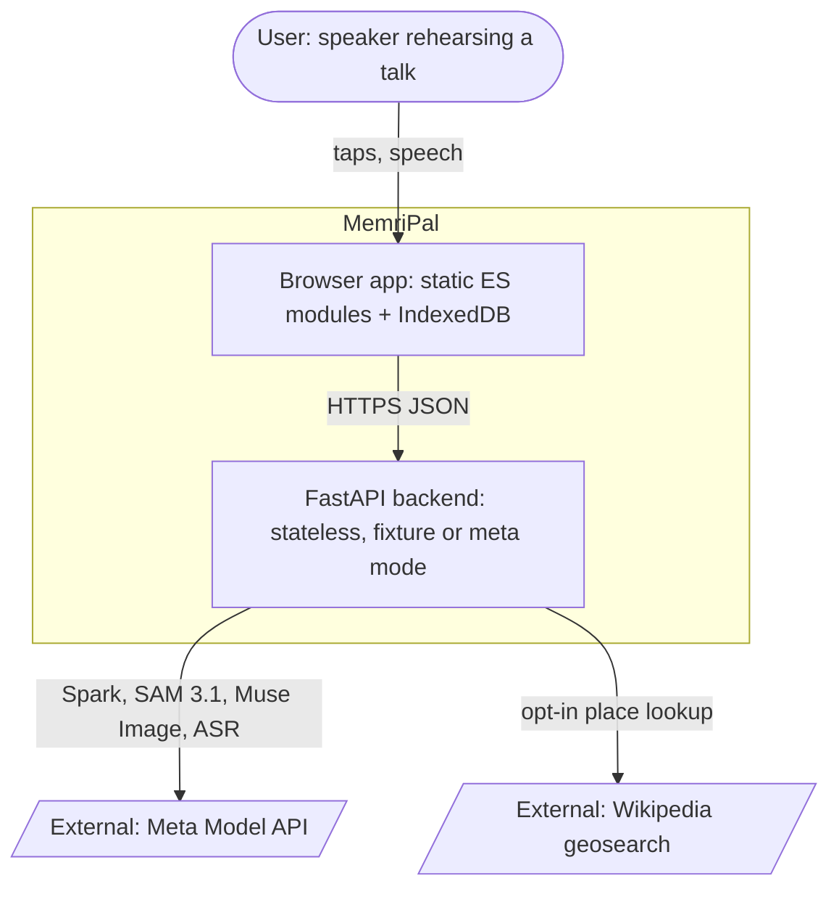
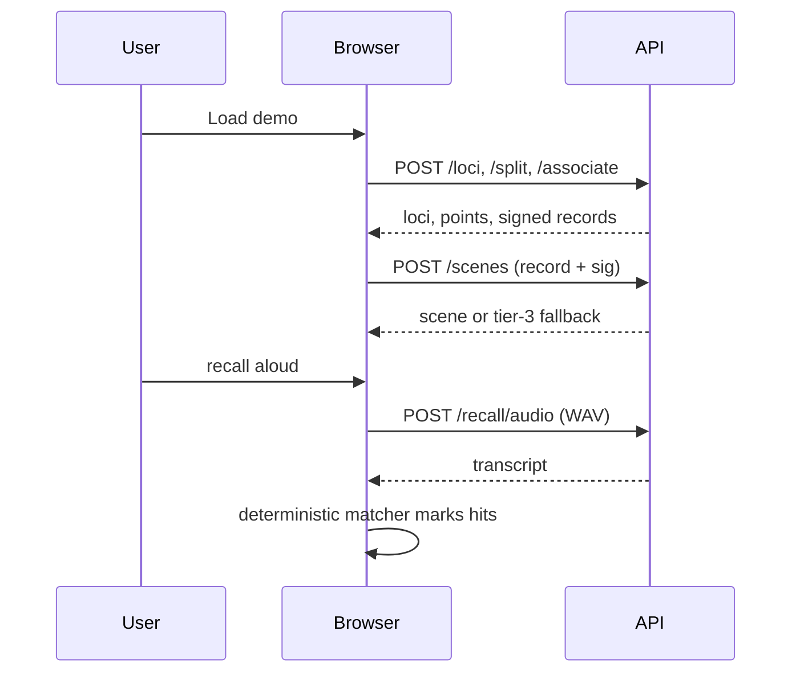

# MemriPal onboarding

A place-based recall coach for speeches: study points pinned to stops on a walk you know, recalled aloud,
checked by deterministic code.

## ELI5

You have a talk to give. MemriPal ties each point to a place on a walk you know, draws a silly picture for each
place, then listens while you walk it in your head and say the points. It tells you which ones you forgot.

## WHY

Building a memory palace by hand is slow and self-checking is unreliable. MemriPal automates the build with Meta
models and keeps judging model-free, so a paraphrase cannot talk its way into a pass
([ADR 0008](decisions/0008-spoken-recall-deterministic-matcher.md)). Built for the Meta Global AI Developer
Hackathon (Oct 26 - Nov 4 2026).

## WHAT

- Stateless FastAPI backend (`src/memripal/app.py::create_app@h46203aac`); palaces, routes and rehearsals live in
  the browser ([ADR 0003](decisions/0003-stateless-backend-client-state.md)).
- Vanilla ES-module frontend in `static/`, no build step; page wiring in `static/flow.js:151@h9770af0c`.
- Modes `fixture` (default, offline replay) and `meta` (live API), picked by
  `src/memripal/backend.py::select_backend@hc1241b9b`.
- Direction is route-first ([ADR 0038](decisions/0038-route-first-flow.md)); the served Load demo still runs the
  room-photo chain until plan step B10 ([ADR 0040](decisions/0040-retire-room-photo-flow.md)).

## HOW: architecture

Legend: rounded = person, slanted = external system, boxes = MemriPal containers.

Guards run outermost-first: `src/memripal/security_headers.py::SecurityHeaders@h8fb65e8b`, trusted host, rate
limit `src/memripal/ratelimit.py::ApiGuard@had0c95f5`, then a per-route live passcode
([ADR 0025](decisions/0025-passcode-gate-and-host-allowlist.md)).

## HOW: sequence

## HOW: core logic

- Loci: `src/memripal/loci.py::find_loci@ha9e0fdb1` gets Spark phrases and SAM boxes;
  `src/memripal/loci.py::select_loci@hba799d24` and `src/memripal/loci.py::route_order@h636749ea` pick and order
  them with no LLM.
- Split: list mode `src/memripal/split.py::split_list@h0495acc9`; notes mode, one Spark call plus one
  regeneration, `src/memripal/split.py::split_notes@hffee42f8`.
- Associate: `src/memripal/associate.py::validate_association@h83acf155` checks records;
  `src/memripal/associate.py::associate@h68000bc3` regenerates at most twice, then `invalid`.
- Signing: `src/memripal/record_sign.py::sign_record@h5edfb9b0`; `/scenes` renders only records passing
  `src/memripal/record_sign.py::sig_ok@ha2044792`.
- Recall: Levenshtein 0.8 or 60% coverage (`static/recall_match.js:5-6@hfe3a890c`) in
  `static/recall_match.js:139@h15683138`; live lighting relays 5 s slices (`static/recall_live.js:7@hc4d69590`).
- Routes hold 3-8 stations (`static/route_store.js:28-29@h14ec9f79`); the Kendall demo route is frozen code
  (`static/demo_route.js:15@h1f2f12a6`).

## HOW: data provenance

- Replays in `fixtures/replay/` keyed by `src/memripal/backend.py::RequestKey@h53469c95` or legacy
  `src/memripal/backend.py::CacheKey@h19661f99`; a miss raises in `src/memripal/backend.py::FixtureBackend@h0cdbe15e`.
- Live calls write to gitignored `refs/private/live-cache` ([ADR 0017](decisions/0017-live-cache-in-refs-private.md)).
- Demo inputs are synthetic (`fixtures/MANIFEST.md`); uploads are re-encoded, EXIF-stripped
  (`src/memripal/imaging.py::process_upload@he12c147e`).
- Wikipedia place text (CC BY-SA 4.0), opt-in only: `src/memripal/place.py::PlaceProvider@h4981c888`.
- Backups carry no coordinates, 8 MiB cap (`static/palace_export.js:14@h9109ef78`).

## HOW: key files

| Path | Role |
| --- | --- |
| `src/memripal/app.py` | App factory, routes, deploy guards |
| `src/memripal/backend.py` | Modes, `ModelRequest`, replay cache |
| `src/memripal/meta_client.py` | Meta HTTP client (`src/memripal/meta_client.py::MetaClient@he9f80c07`) |
| `src/memripal/loci.py`, `split.py`, `associate.py`, `scenes.py` | Encode pipeline stages |
| `static/flow.js`, `static/encode.js` | Page wiring; Load demo chain (`static/encode.js:298@hdb257aca`) |
| `static/route_store.js`, `static/real_map.js` | Route store; Kendall map (`static/real_map.js:13-15@h2e400328`) |
| `docs/decisions/` | ADRs |
| `.claude/spec-cache/memripal/references/` | Feature specs (MEM-NNN) |

## HOW: CLI, env vars, exit codes

| Env var | Effect |
| --- | --- |
| `MEMRIPAL_MODE` | `fixture` (default) or `meta`; else raises |
| `META_API_KEY` | Required in `meta` mode, environment only |
| `MEMRIPAL_CHAT_PROVIDER` | `src/memripal/chat_provider.py::chat_provider_from_env@h1383f730` |
| `MEMRIPAL_SEG_PROVIDER` | `src/memripal/seg_provider.py::select_seg_provider@h02e2a8e3` |
| `MEMRIPAL_PASSCODE`, `MEMRIPAL_ALLOWED_HOSTS`, `MEMRIPAL_CALL_BUDGET` | Deploy guards, read in `create_app` |
| `MEMRIPAL_RECORD_KEY` | HMAC key, else random per process (`src/memripal/record_sign.py::record_key@h4a72c634`) |

Commands: `uv run uvicorn memripal.app:app`, `sh scripts/check.sh`, `sh scripts/merge_branch.sh <worktree>`.
Script exit codes: 0 clean, 1 failure, 2 bad usage (README "Setup").

## HOW: tests

- Python `tests/test_*.py`, per module or route; lint runs inside pytest ([ADR 0037](decisions/0037-lint-in-pytest.md)).
- Frontend `static/*.test.mjs` under `node --test`; design previews `docs/design/v6/tests/*.test.mjs`.
- End to end: `scripts/e2e_drive.py` (22 Playwright steps, not in `scripts/check.sh`).

## HOW: design decisions

Index: [decisions/README.md](decisions/README.md). Load-bearing:
[0002](decisions/0002-backend-modes-and-replay-cache.md) modes and replay cache;
[0003](decisions/0003-stateless-backend-client-state.md) stateless backend;
[0026](decisions/0026-client-side-recall-matcher.md) client-side matcher;
[0020](decisions/0020-association-validate-and-regenerate.md) bounded regeneration;
[0027](decisions/0027-signed-association-records.md) signed records;
[0038](decisions/0038-route-first-flow.md) route-first; [0041](decisions/0041-real-map-whole-file-pmtiles.md) real map.

## HOW: gotchas

- `/station` and `/baseline` routers are not mounted by `create_app`
  (`src/memripal/routes_station.py::make_station_router@hca85b376`,
  `src/memripal/routes_baseline.py::baseline_router@h9453b53d`).
- CORS unwired (`src/memripal/cors.py::add_cors@h3e407690`): the Android shell cannot reach the API yet.
- `src/memripal/stt_provider.py::select_stt_provider@hdf37e953` has no app caller; `/recall/audio` always uses Muse.
- `static/db/` SQLite worker (`static/db/client.js:1@hb0f07ec9`) has no non-test caller; stores use IndexedDB.
- The README pipeline diagram still shows the room-photo flow.

## Remaining owner gates

- Kev: replace README `TODO(Kev)` video and Cloud Run URLs; close `docs/submission/checklist.md` items.
- Plan B10: Load demo -> demo route, delete `/loci` ([ADR 0040](decisions/0040-retire-room-photo-flow.md)).
- Wire `/station`, `/baseline` and CORS into `create_app`.
